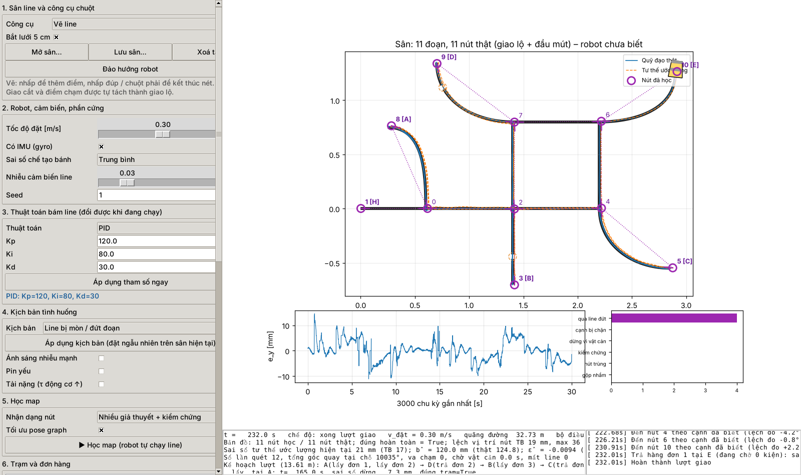
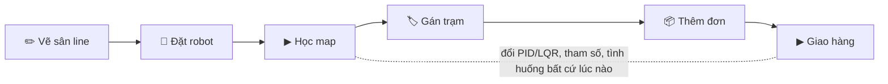
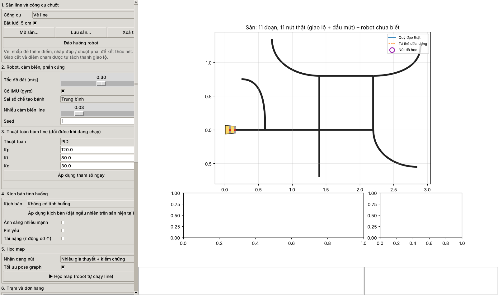
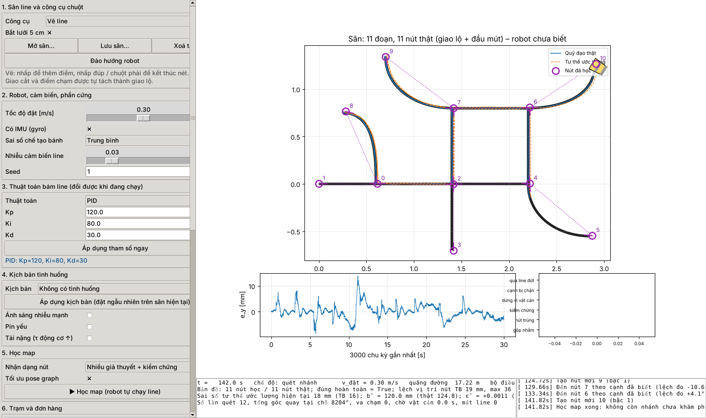
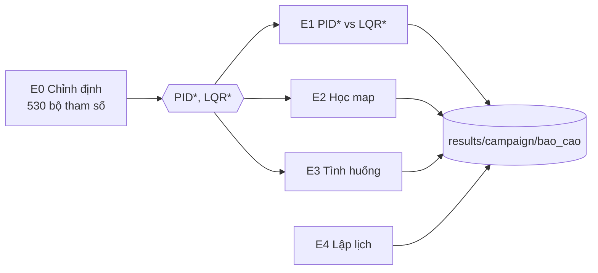
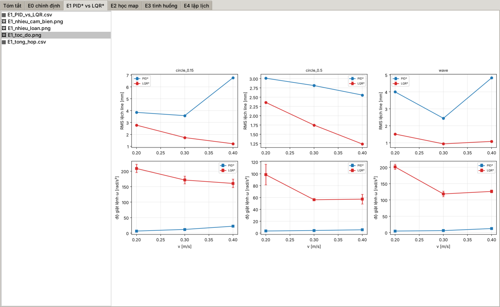

# 🤖 Robot giao hàng bám line – tự học map, mô phỏng

Học phần Kỹ thuật Robot · Đề tài: *robot vận chuyển hàng trong kho thông minh* · Hướng: **mô hình hoá và mô phỏng (Python)**

Robot tự chạy trên mạng line **chưa biết trước**, tự dựng bản đồ nút–cạnh, rồi giao hàng giữa các trạm do người dùng gán.

📄 Báo cáo cuối kỳ: [`report/BaoCao_KyThuatRobot.pdf`](report/BaoCao_KyThuatRobot.pdf) (bản Word: `report/BaoCao_KyThuatRobot.docx`)



## Cài đặt và chạy

```bash
pip install -r requirements.txt
```

```bash
python gui.py
```

Cần Python 3.9+ có `tkinter`.

## Quy trình trên GUI



| Bước | Thao tác |
|---|---|
| Vẽ sân | Công cụ *Vẽ line*: nhấp thêm điểm, nhấp đúp kết thúc. Giao cắt tự thành giao lộ. Mẫu: `maps/` |
| Học map | Robot tự bám line, quét nhánh, khám phá DFS, hiệu chuẩn odometry, tối ưu pose graph |
| Gán trạm | Công cụ *Gán trạm*, nhấp vào nút đã học (vòng tím) |
| Giao hàng | *Thêm đơn* chỉ đưa vào hàng chờ; *▶ Giao hàng* mới chạy. Chọn lập lịch và sức chứa |
| Tình huống | Người đi ngang, vật cản, line mòn, sàn trơn, nhiễu sáng, pin yếu, tải nặng |

| Sân vẽ tay | Sau khi học map |
|---|---|
|  |  |

## Bộ điều khiển

| | PID | LQR / LQI |
|---|---|---|
| Tham số trên GUI | Kp, Ki, Kd | e_y, e_θ, ω cho phép, ∫e_y (0 = tắt) |
| Mặc định (chỉnh định tự động) | **120 / 80 / 30** | **1 mm, 10°, 3 rad/s, 8 mm·s** |
| Hành vi | ↑Kp: nhanh, vọt lố hơn · ↑Kd: giảm vọt lố · ↑Ki: hết sai lệch tĩnh | tối ưu theo trọng số Q, R |

## Bộ thí nghiệm cho báo cáo (≈ 1 phút)

GUI khung **7** → *▶ Chạy bộ thí nghiệm* → *Xem kết quả* → *Áp dụng PID\*, LQR\**

```bash
python experiments/campaign.py
```



| | Nội dung | Lượt |
|---|---|---:|
| E0 | Lưới Kp×Ki×Kd (210) và LQR/LQI (320); bước, động cơ lệch, đường hỗn hợp 3 tốc độ, đường tròn | 4240 |
| E1 | Đường kiểm tra độc lập × tốc độ 0,2–0,4 m/s × nhiễu × nhiễu loạn, 5 seed, kiểm định Welch | 200 |
| E2 | 2 sân × 3 mức sai số bánh × 4 cấu hình (IMU, nhận dạng nút, pose graph) | 48 |
| E3 | 8 tình huống × PID\*/LQR\* | 32 |
| E4 | FIFO / tham lam / quy hoạch động × sức chứa × số đơn | 1620 |



**Kết quả chính** (`results/campaign/bao_cao/`):

| Chỉ tiêu | PID\* | LQR\* (LQI) |
|---|---:|---:|
| RMS lệch line, đường kiểm tra | 3,8 mm | **1,6 mm** |
| Độ giật lệnh ω | **9 rad/s²** | 133 rad/s² |
| Bản đồ đúng (cấu hình đề xuất) | 100 % | 100 % |

Nút **📑 Xuất dữ liệu cho báo cáo** (khung *Mô phỏng*) xuất bảng/hình của các lượt chạy tay trên GUI.

## Cấu trúc

```
gui.py              giao diện
sim/
  world.py          sân line, cảm biến, tình huống
  robot.py          động học vi sai, động cơ, encoder, gyro, odometry
  control.py        ước lượng e_y, e_θ · PID · LQR/LQI
  batch.py          mô phỏng N robot song song (chỉnh định nhanh)
  agent.py          bám line, vào nút, quét nhánh, khám phá, giao hàng
  mapping.py        bản đồ topo, nhận dạng nút, pose graph SE(2), Dijkstra
  planning.py       lập lịch FIFO / tham lam / quy hoạch động
  export.py, report_export.py   xuất dữ liệu lượt chạy GUI
experiments/        campaign.py · campaign_report.py · campaign_config.json · diagrams.py
results/campaign/   dữ liệu thô, tham số tốt nhất, bảng/hình báo cáo
